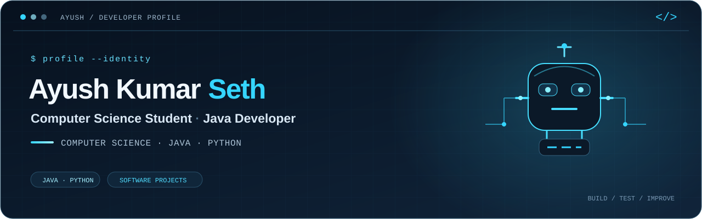

 

**Computer Science student · Java & Python developer · Building practical software**

[About](#about) &nbsp; · &nbsp; [Projects](#selected-projects) &nbsp; · &nbsp; [Toolkit](#toolkit) &nbsp; · &nbsp; [Journey](#experience--education) &nbsp; · &nbsp; [Stats](#github-at-a-glance)

---

## About

Hey, I’m **Ayush Kumar Seth**, a Computer Science and Engineering student. I enjoy turning ideas into useful applications and learning how software systems fit together.

My projects span Java applications, Python tools, and web apps backed by relational and document databases. I’m strengthening my foundations in data structures, problem solving, and software development, with a focus on writing clear, dependable code.

> **Current focus:** growing as a well-rounded developer through hands-on projects and consistent practice.

## Selected projects

| Project | Overview | Built with |
| :--- | :--- | :--- |
| [**Bookstore Management API**](https://github.com/ayushkr063/bookstore_management) | REST API for book catalog, authentication, and order workflows. | Java · Spring Boot · MongoDB |
| [**MediCore Hospital Management**](https://github.com/ayushkr063/hospital-management) | Web app for patient records, search, and admission status management. | Python · Flask · MySQL |
| [**Student Study Planner**](https://github.com/ayushkr063/-study-planner) | College planner for subjects, tasks, and study progress. | Python · Flask · MySQL |
| [**Personal Productivity Suite**](https://github.com/ayushkr063/personal_productivity_suite) | Modular CLI with notes, calculator, timer, file organizer, converter, and backup tools. | Python · JSON · CSV |
| [**CodSoft Java Internship Projects**](https://github.com/ayushkr063/CODSOFT_TASKS) | Number-guessing game, ATM interface, and quiz application. | Java · Java Swing · OOP |

## Toolkit

**Languages**  

-101E30?style=flat-square&logo=c&logoColor=43D8FF)

**Frameworks & data**  

**Tools & practices**  
Git · GitHub · VS Code · Object-oriented programming · Input validation · Exception handling · Debugging

## Currently learning

- Data structures and algorithms
- Problem-solving patterns
- Building and refining software projects

## Experience & education

### Java Development Intern · CodSoft
*Virtual · September 2026 · Four weeks*

- Built a number-guessing game, ATM interface, and quiz application using Java and Java Swing.
- Practiced object-oriented design, input validation, exception handling, and GUI development.

### B.Tech · Computer Science and Engineering

## What I’m working toward

I’m focused on becoming a stronger software developer by deepening my programming fundamentals, building practical applications, and exploring new technologies. I’m especially interested in software development with Java and Python.

## GitHub at a glance

---

**Let’s connect**  
[GitHub](https://github.com/ayushkr063) &nbsp; · &nbsp; [LinkedIn](https://www.linkedin.com/in/ayush-kumar-seth)

BUILD / TEST / IMPROVE

