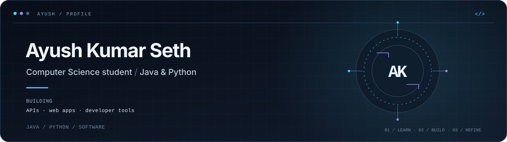

[GitHub](https://github.com/ayushkr063) &nbsp; · &nbsp; [LinkedIn](https://www.linkedin.com/in/ayush-kumar-seth)

**Computer Science student building with Java and Python**

---

## About

I’m Ayush, a Computer Science student interested in backend and application development. I learn by building: from Java APIs and Python command-line tools to small web applications. I care about clear structure, useful features, and documenting how a project works.

## Selected work

### [Bookstore Management API](https://github.com/ayushkr063/bookstore_management)

A Java REST API for accounts, book discovery, and order workflows. Includes JWT authentication, MongoDB persistence, inventory checks, and OpenAPI documentation.

**Java 21** · **Spring Boot** · **Spring Security** · **MongoDB**

### [Personal Productivity Suite](https://github.com/ayushkr063/personal_productivity_suite)

A Python command-line toolkit for notes, calculations, timers, file organization, unit conversion, and backups. Uses the standard library and includes tests.

**Python** · **CLI** · **JSON / CSV** · **pytest**

### [Student Study Planner](https://github.com/ayushkr063/-study-planner)

A Flask and MySQL web app for organizing subjects and study tasks, with account access, dashboards, and task management.

**Python** · **Flask** · **MySQL** · **HTML / CSS / JavaScript**

More projects

- [MediCore Hospital Management](https://github.com/ayushkr063/hospital-management) — Flask and MySQL application for patient records, search, and admission status.
- [CodSoft Java exercises](https://github.com/ayushkr063/CODSOFT_TASKS) — number-guessing game, ATM interface, and quiz application developed during a Java internship.

## Toolkit

**Languages**  

-101827?style=flat-square&logo=c&logoColor=9C8CFF)

**Frameworks & data**  

**Tools & practices**  
Git · GitHub · VS Code · Object-oriented programming · Input validation · Debugging

## Experience & education

**Java Development Intern · CodSoft**  
*Virtual · September 2026 · Four weeks*  
Built a number-guessing game, ATM interface, and quiz application using Java and Java Swing.

**B.Tech, Computer Science and Engineering** · 2024–2028

## Current focus

Strengthening data structures and problem-solving fundamentals while building and refining practical software projects.

## GitHub activity

---

[GitHub](https://github.com/ayushkr063) &nbsp; · &nbsp; [LinkedIn](https://www.linkedin.com/in/ayush-kumar-seth)

